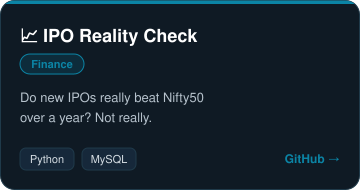
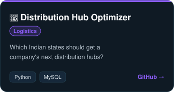
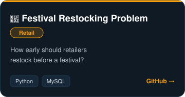

<h2 align="center">🌟 About Me</h2>

I'm a data enthusiast who likes building new things out of data, and I'm looking for a better opportunity to do it for real. So far I've made 9 projects across different sectors. My latest and biggest ones are below.

🟢 <b>Open to work:</b> Data Analyst roles

<h2 align="center">🏆 Featured Projects</h2>

  

<h2 align="center">🚀 Technical Skills</h2>

<b>Programming & Databases</b> 
    

<b>Data Analysis</b> 
      

<b>Visualization & BI</b> 
  

<b>Modeling & ML</b> 
    

<h2 align="center">📫 Connect With Me</h2>

    

